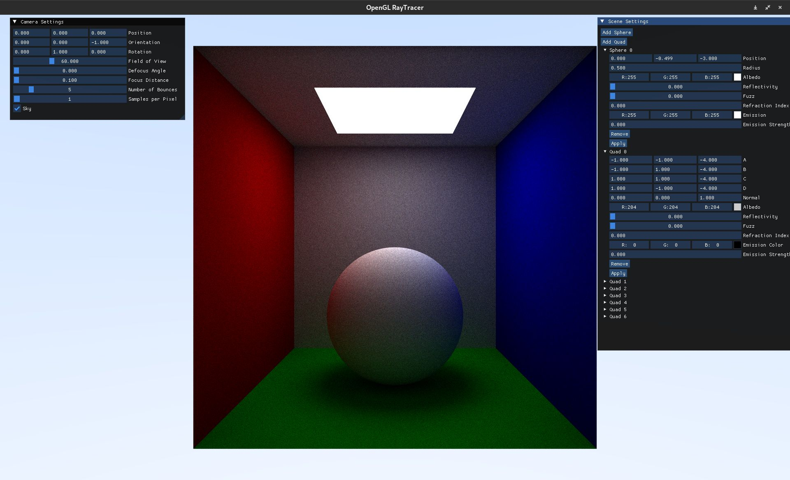
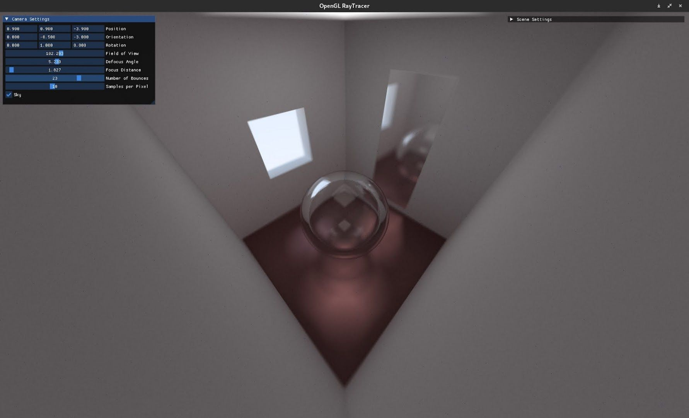
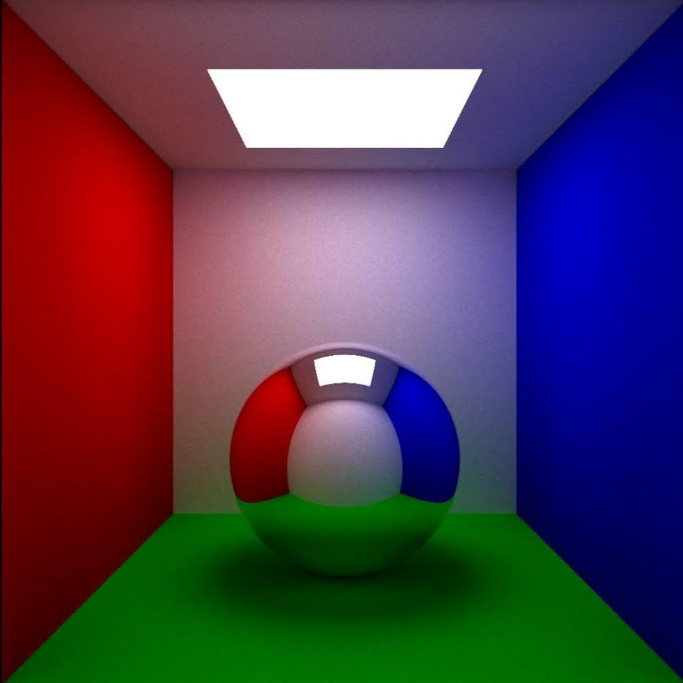
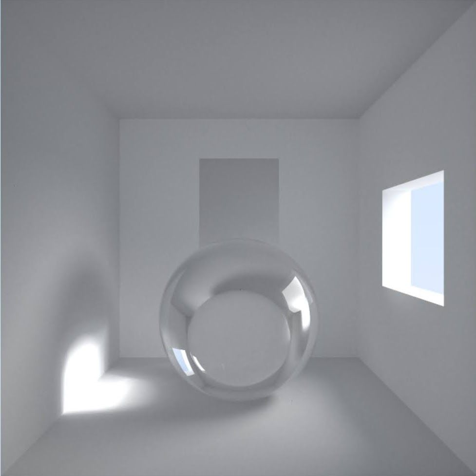

# Render engine - Project for 3D Grafika

Render engine is a simple desktop application that utilises openGl and imgui to preview and render out 3D scenes.

## Preview

Here are some example renders produced by the engine:






## Prerequisites

- OpenGL v3.3  
- GLFW v3.3  

## References

- ImGui code — [ocornut/imgui](https://github.com/ocornut/imgui)  
- Some OpenGL code — [learnopengl.com](https://learnopengl.com)


## Instructions

To clone project:

````
git clone https://github.com/IvanSiljic/3DProject.git
````

Open folder in terminal and run next commands:

```
cmake .
make -j4
```
Those commands should provide you with executable named 3DProject
